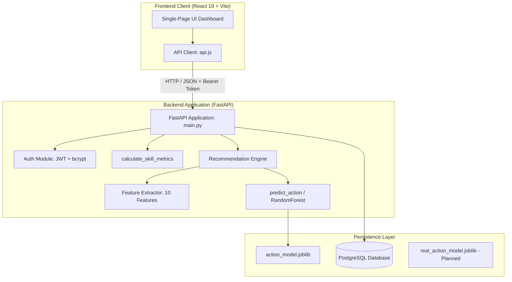
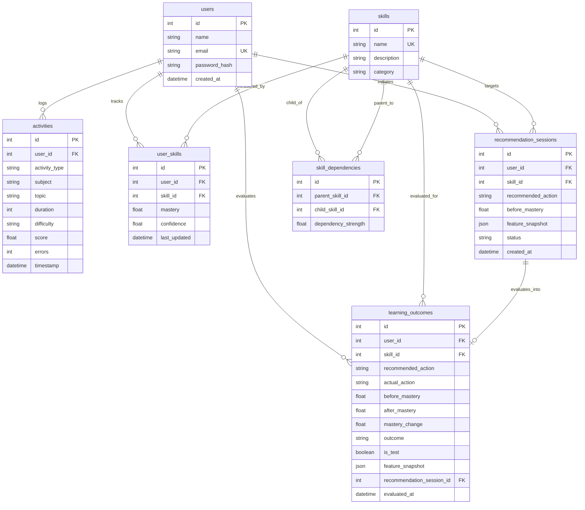
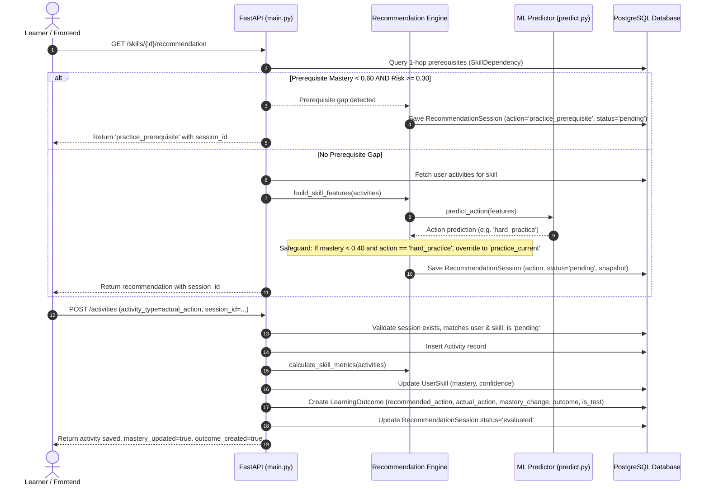

# CWIP --- Technical Architecture Specification

**Version:** 1.0 (Audited)  
**Date:** 31 October 2026  
**Auditor:** Lead Software Architect & Senior Full-Stack AI Engineer  
**Source of Truth:** Repository Tree (`C:\Users\DELL\Desktop\CWIP`)

---

## 1. System Overview

CWIP (Cognitive Workflow Intelligence Platform) is an adaptive learning intelligence platform. Rather than merely recording quiz scores, CWIP tracks learner activities, models micro-skill mastery and prerequisite risk, generates targeted next-action recommendations, links activities to recommendation sessions, and computes post-activity learning outcomes and adherence rates.

---

## 2. Technology Stack & Runtime Configuration

### Confirmed in Active Use

| Layer | Technology | Version / Notes |
| :--- | :--- | :--- |
| **Frontend Runtime** | React 19, Vite 8, Recharts 3, Lucide React 1 | Single-page architecture without client router (`react-router`) |
| **Backend Runtime** | Python 3.14.0, FastAPI 0.162.0, Starlette 1.10.0, Uvicorn 0.30.6 | Local ASGI server running on port 8000 |
| **Persistence / ORM** | PostgreSQL 16+ via `psycopg` (3.2.10) & SQLAlchemy 2.0.35 | Dynamic engine instantiation via `DATABASE_URL` |
| **Test Database** | SQLite (in-memory / temp file) via Pytest fixtures | Isolated per test session |
| **Machine Learning** | `scikit-learn` 1.9.1 (`RandomForestClassifier`), Pandas 3.0.6, NumPy 2.5.3 | 100 estimators, balanced class weights, Joblib 1.6.0 serialization |
| **Authentication** | `python-jose` (HS256 JWT) + `passlib` (`bcrypt`) | Custom `HTTPBearer(auto_error=False)` with 403 on missing, 401 on invalid |

### Unimplemented / Proposed in Historical Notes Only

The following technologies were noted in early project proposals but **do not exist** anywhere in the current repository:
- **Redis & Celery:** No message broker, worker processes, or async task queues exist. All operations run synchronously.
- **NetworkX & Neo4j:** Graph operations are performed via direct 1-hop SQL queries against `skill_dependencies`. No graph library or graph database is present.
- **Docker / Docker Compose:** No container manifests exist.
- **SHAP & XGBoost:** No explainability trees or gradient boosting models are installed or referenced.

---

## 3. Database Architecture & Schema

The persistent data layer is implemented in PostgreSQL and modeled via SQLAlchemy declarative base in `backend/app/models.py`.

### Key Schema Observations & Constraints

1. **Missing ORM Relationships:** The models declare `ForeignKey("...")` columns but omit SQLAlchemy `relationship(...)` properties. Joins are manually written as explicit `.filter()` queries.
2. **Missing Unique Constraints:** `user_skills` does not have a `UniqueConstraint("user_id", "skill_id")`. Duplicate rows are prevented only via procedural application checks.
3. **Migration Management:** No migration tool (such as Alembic) is configured. Table schemas were created with `Base.metadata.create_all(bind=engine)`, and column additions (`created_at`, `evaluated_at`) were applied manually via PostgreSQL CLI.
4. **Top-Level Table Creation:** `backend/app/main.py:34` invokes `Base.metadata.create_all(bind=engine)` upon module import, which forces a live connection to PostgreSQL whenever `main.py` is loaded.

---

## 4. Recommendation Engine & Lifecycle

The recommendation engine connects diagnosis, machine learning prediction, learner activity submission, and outcome evaluation.

### Controlled Action Space (`backend/app/ml/actions.py`)

All recommendations and learner-reported activities are restricted to exactly six canonical string codes:
1. `practice_current` --- Practice the current skill
2. `practice_prerequisite` --- Strengthen a weak prerequisite skill
3. `review_concept` --- Review foundational concept notes
4. `easy_practice` --- Attempt introductory/simpler problems
5. `hard_practice` --- Challenge advanced problems
6. `take_assessment` --- Undergo formal diagnostic assessment

### Recommendation Session Lifecycle Flow

---

## 5. Machine Learning Pipeline Architecture

### 10-Feature Skill Vector (`backend/app/ml/features.py`)

Feature vectors capture the historical state of a learner for a given skill:

| Feature | Calculation / Definition |
| :--- | :--- |
| `average_score` | Arithmetic mean of all scored activities ($0 - 100$). |
| `recent_score` | Mean of up to the last 3 scored activities ($0 - 100$). |
| `adjusted_score` | Scores weighted by difficulty (`easy`=0.8, `medium`=1.0, `hard`=1.3) normalized by average difficulty. |
| `avg_difficulty_weight` | Mean difficulty weight across all scored activities. |
| `consistency` | $1 - (\text{pstdev}(\text{scores}) / 50)$, bounded to $[0, 1]$. |
| `error_rate` | $\text{total\_errors} / \max(\text{total\_duration}, 1)$. |
| `mastery` | Weighted combination: $0.40 \cdot \frac{\text{avg}}{100} + 0.30 \cdot \frac{\text{recent}}{100} + 0.20 \cdot \text{consistency} + 0.10 \cdot \text{error\_score}$. |
| `confidence` | $\min(1.0, \frac{\text{count}}{5} \cdot 0.6 + \text{consistency} \cdot 0.4)$. |
| `activity_count` | Total count of activities for this skill. |
| `trend` | $+1$ if $\text{recent} > \text{avg} + 5$; $-1$ if $\text{recent} < \text{avg} - 5$; else $0$. |

### Synthetic Development Model (`action_model.joblib`)

- Generated by `backend/app/ml/train_model.py` using 600 synthetic records from `synthetic.py`.
- Trained via `RandomForestClassifier(n_estimators=100, random_state=42, class_weight='balanced')`.
- All rows marked `is_synthetic=True`.
- Reaches high accuracy ($\approx 98\%$) because it learns deterministic synthetic policy rules. **This is policy imitation, not verified real-world pedagogical efficacy.**

### Real Model Training Path (`train_real_model.py`)

- Script: `python -m backend.app.ml.train_real_model --user-id <id>`.
- Target artifact: `real_action_model.joblib` (guaranteed never to overwrite `action_model.joblib`).
- **Gating Requirements:**
  - $\ge 30$ real, non-test samples for the specific user.
  - $\ge 2$ distinct action classes.
  - Full valid 10-feature snapshot matching `REQUIRED_FEATURES`.
  - Non-synthetic flag `is_synthetic=False`.
- **Target Variable Semantics:** Current implementation uses `recommended_action` as the training label `y`, meaning it trains an imitation model of the existing recommendation policy, rather than an outcome-optimizing or adherence-prediction model.

---

## 6. Data Modes and Test Separation

The platform distinguishes prototype/test records from genuine learner data via `backend/app/config.py`:
- `CWIP_DATA_MODE="development"` (Default): Outcomes created are stamped with `is_test=True`.
- `CWIP_DATA_MODE="real"`: Outcomes created are stamped with `is_test=False`.
- Controlled strictly on the backend. Client submissions cannot specify or override `is_test`.

---

## 7. Frontend Integration Architecture

The frontend is a React 19 single-page dashboard without client-side routing. All views are switched via top-level state `active`:
- **Overview:** Top metrics, skill mastery summary bars, recommendation prompt, latest 10 activities table.
- **My Skills:** Dynamic skill catalogue rendering enrolled skills (mastery bars, confidence, trend, analytics, recommendation CTA, profile inspection modal) alongside available unenrolled skills (domain discovery, enrollment CTA).
- **Recommendations:** Active recommendation card, actual action dropdown (`activityForm.actualAction`), duration, difficulty, score, errors, submission button.
- **Learning Progress:** Score trend line chart, score/time metrics, and comprehensive **Learning Effectiveness Analytics** (empirical $\Delta \text{mastery}$ KPIs, recommendation adherence comparison cards [followed vs non-followed], skill-wise and action-wise breakdowns, and observational caveat notice).
- **Learning Outcome History:** Searchable, filterable outcome table, breakdown of test vs real records, outcome detail inspection modal.

### API Communication

Implemented in `frontend/src/api.js`:
- Base URL: `http://127.0.0.1:8000`.
- Auth header: `Authorization: Bearer <token>` retrieved from `localStorage.getItem("cwip_token")`.
- Skill Catalogue & Profile endpoints (`GET /skills`, `GET /skills/{id}`, `POST /skills/{id}/enroll`, `GET /skills/{id}/profile`).
- Dynamic query parameters for test vs real outcome filtering (`GET /learning-outcomes?is_test=...`).
- Learning Effectiveness analytics query (`GET /analytics/effectiveness?skill_id=...`).

---

## 8. Learning Effectiveness Analytics Architecture

Effectiveness analytics measure genuine learning improvement ($\Delta \text{mastery} = \text{post\_mastery} - \text{pre\_mastery}$) across evaluated real-world outcomes (`is_test=False`), maintaining strict conceptual and architectural separation from action adherence.

### Endpoint Contract: `GET /analytics/effectiveness`

- **Authentication:** Required (User-isolated via JWT bearer token).
- **Query Parameters:** `skill_id` (optional integer).
- **Data Filtering:** Restricts to `user_id == current_user.id`, `is_test == False`, and `mastery_change != None`.
- **Response Structure:**
  - `total_real_evaluated`: Total genuine evaluated outcomes.
  - `average_mastery_change`: Mean mastery change across all genuine outcomes.
  - `positive_outcomes`: Outcomes with $\Delta \text{mastery} > +0.05$.
  - `neutral_outcomes`: Outcomes within $[-0.05, +0.05]$.
  - `negative_outcomes`: Outcomes with $\Delta \text{mastery} < -0.05$.
  - `by_skill`: Per-skill aggregations (`skill_id`, `skill_name`, `sample_count`, `average_mastery_change`, outcome distribution).
  - `by_recommended_action`: Aggregations grouped by recommendation delivered.
  - `by_actual_action`: Aggregations grouped by learner's actual recorded activity.
  - `comparison_by_adherence`: Contrast between `followed` (adherent) and `not_followed` (divergent) actions.
  - `observational_caveat`: Mandatory methodological notice declaring that observational historical correlations do not prove pedagogical causality.

---

## 9. Skill Catalogue & Learner Profile Architecture

Dynamic skill management transitions CWIP away from hardcoded skills by providing full catalogue discovery, safe enrollment, and deep profile inspection.

### Endpoint Contracts

1. **`GET /skills` (Catalogue Discovery):**
   - Public / Optional Auth: Returns list of all skills.
   - When authenticated, annotates each skill with `is_enrolled: bool`, `mastery: float | None`, and `confidence: float | None`.

2. **`GET /skills/{skill_id}` (Skill Details):**
   - Returns skill attributes (`id`, `name`, `description`, `category`) with learner enrollment metadata.

3. **`POST /skills/{skill_id}/enroll` (Safe Transactional Enrollment with Concurrency Control):**
   - Requires Authentication (`User` bearer token).
   - Verifies skill existence (404 on unknown ID).
   - Concurrency serialization: Acquires a PostgreSQL row-level lock on the authenticated learner's `User` record via SQLAlchemy `query.with_for_update()`. This serializes concurrent enrollment requests across multiple client requests for the same user without requiring table-level locks.
   - Enforces transactional uniqueness: checks existing `UserSkill` record after acquiring the lock and raises HTTP 400 (`Learner is already enrolled in this skill`) to prevent duplicate rows without requiring database DDL schema modifications.
   - Rollback safeguard: Catches `sqlalchemy.exc.IntegrityError` upon `db.commit()`, issues an explicit `db.rollback()`, and cleanly reports duplicate enrollment (HTTP 400).
   - Initializes `UserSkill` with `mastery=0.0`, `confidence=0.0`, and timestamp `last_updated`.

4. **`POST /skills` (Administrative Skill Creation Boundary):**
   - Requires Authentication (`User` bearer token).
   - Authorization Guard: Global skill creation is restricted from ordinary learners. Raises HTTP 403 (`Global skill creation is disabled. Administrative privileges required.`). Internal/seed skills are populated directly via database sessions or administrative seeding scripts until a formal RBAC model is introduced.
   - Schema Validation (`SkillCreate`): Validates skill name, trims leading/trailing whitespace, and rejects names shorter than 2 characters (`min_length=2`).

5. **`GET /skills/{skill_id}/profile` (Empirical Learner Profile):**
   - Requires Authentication (`User` bearer token).
   - Aggregates live learner data across `UserSkill`, `Activity`, and genuine `LearningOutcome` tables:
     - `is_enrolled`, `enrolled_at`, `mastery`, `confidence`, `trend`.
     - `total_activities`: total activities logged for this topic.
     - `recent_activity`: timestamp, score, difficulty, and duration of the latest activity.
     - `total_real_evaluated`: genuine evaluated outcomes.
     - `positive_outcomes`, `neutral_outcomes`, `negative_outcomes`.
     - `average_mastery_change`: average $\Delta \text{mastery}$ (returned as `None` when 0 outcomes to avoid fabricating 0.0).
     - `adherence`: recommendations followed, not followed, and percentage adherence rate (`None` when 0 outcomes).

---

## 10. Prerequisite Graph Intelligence & NetworkX Integration (Phase 4)

### 10.1 Directed Acyclic Graph (DAG) Representation

CWIP models curricular prerequisite dependencies as a directed acyclic graph (DAG) using `networkx.DiGraph`:

- **Directional Edge Convention:**
  A directed edge $u \to v$ (`parent_skill_id -> child_skill_id`) strictly denotes:
  $$\text{Prerequisite Skill } (u) \longrightarrow \text{Dependent Skill } (v)$$
  - **Predecessors & Ancestors:** `G.predecessors(v)` and `nx.ancestors(G, v)` correspond to upstream **prerequisites** that must be mastered before skill $v$.
  - **Successors & Descendants:** `G.successors(u)` and `nx.descendants(G, u)` correspond to downstream **dependent skills** that require skill $u$.
  - **Isolated Nodes:** Graph construction (`build_skill_graph(db)`) pulls all `Skill` rows into `G`, ensuring foundational skills with zero prerequisites are preserved as valid nodes.

### 10.2 Cycle Prevention & Graph Integrity

To guarantee that curriculum structures never enter infinite prerequisite loops:

1. **Pre-insert Cycle Validation (`validate_dependency_addition`):**
   Before committing any dependency edge $u \to v$ (`parent -> child`):
   - **Self-Dependency Check:** $u \neq v$ (rejects self-loops with HTTP 400).
   - **Existence Check:** Verifies both node $u$ and node $v$ exist in `G`.
   - **Duplicate Check:** Rejects edge if $u \to v$ already exists.
   - **Cycle Reachability Detection:** If `nx.has_path(G, source=v, target=u)`, adding edge $u \to v$ would complete a directed cycle. The addition is rejected immediately with HTTP 400 without modifying the database.
2. **Topological Ordering (`get_topological_order`):**
   Evaluates a valid linear curriculum progression via `nx.topological_sort(G)`, guaranteeing that every foundational prerequisite appears before skills that depend upon it.

### 10.3 Multi-Hop Traversal & Deterministic Bottleneck Scoring

Rather than evaluating only immediate 1-hop prerequisites, CWIP traverses the full transitive dependency tree of a target skill $T$:

1. **Transitive Traversal:** Computes all ancestors $P \in \text{Ancestors}(T)$ and their shortest dependency path $P \rightsquigarrow T$ with distance $d \ge 1$.
2. **Learner Evaluation:** Fetches genuine `UserSkill` records for the authenticated learner across all $P$.
3. **Deterministic Bottleneck Scoring Formula:**
   For every prerequisite $P$, potential gaps are flagged if $\text{mastery} < 0.60$ and $\text{risk} \ge 0.30$. Flagged prerequisites are ranked by the deterministic bottleneck formula:

   $$\text{Score} = \max(0, 1 - \text{mastery}) \times \text{strength} \times \left[1 + 0.2 \cdot \max(0, d - 1)\right] \times \left[1 - 0.4 \cdot \min(1, \max(0, \text{confidence}))\right] \times \left[1 + 0.1 \cdot \min(k_{\text{downstream}}, 5)\right]$$

   - **Mastery Deficit:** $\max(0, 1 - \text{mastery})$ drives the core gap severity.
   - **Curricular Strength:** Direct edge weight $\text{strength} \in (0, 1]$.
   - **Root-Foundation Weighting:** $1 + 0.2(d - 1)$ gives deeper foundational blockers ($d > 1$) an escalating urgency bonus to resolve root causes rather than surface-level symptoms.
   - **Confidence Penalty:** Low learner confidence elevates bottleneck score ($1 - 0.4 \cdot \text{confidence}$).
   - **Downstream Impact:** Prerequisites that block multiple downstream topics ($k_{\text{downstream}} = |\text{Descendants}(P)|$) receive an additional multiplier.

### 10.4 Recommendation Engine Integration

In `GET /skills/{skill_id}/recommendation`:
- The engine runs `diagnose_prerequisites(db, user.id, skill_id)` to inspect multi-hop foundations.
- If a weak prerequisite is identified, the system suggests action `review_prerequisites` targeting the primary bottleneck.
- The `RecommendationSession` links to the target skill, records the target/remediated prerequisite details, and stores the explainable chain path in the session record.
- The learner receives human-readable explanations explaining whether the blocker is a direct prerequisite or an indirect foundational root cause.

### 10.5 Phase 4 Endpoint Contracts

1. **`GET /skills/{skill_id}/prerequisites`**: Returns direct and transitive prerequisites with distance, path IDs, and path names.
2. **`GET /skills/{skill_id}/descendants`**: Returns direct and transitive downstream skills that depend on this skill.
3. **`GET /skills/{skill_id}/diagnosis`**: Authenticated learner diagnosis detailing all prerequisites, mastery, confidence, risk, potential gaps, and the primary bottleneck with explainable diagnosis text.
4. **`GET /skills/{source_skill_id}/path/{target_skill_id}`**: Shortest prerequisite path from source to target.
5. **`GET /skills/graph/topological`**: Complete topological curriculum ordering.
6. **`POST /skill-dependencies`**: Administrative dependency boundary. Global prerequisite dependency creation is disabled for ordinary client users (HTTP 403 `Global skill dependency creation is disabled. Administrative privileges required.`). Internal graph seed fixtures and administrative sessions manage dependencies with strict cycle validation and duplicate prevention until formal RBAC is introduced.
